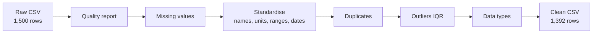
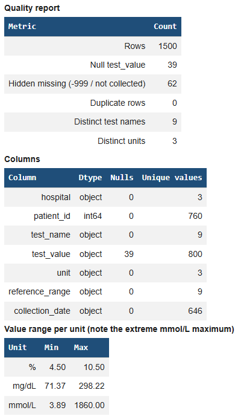
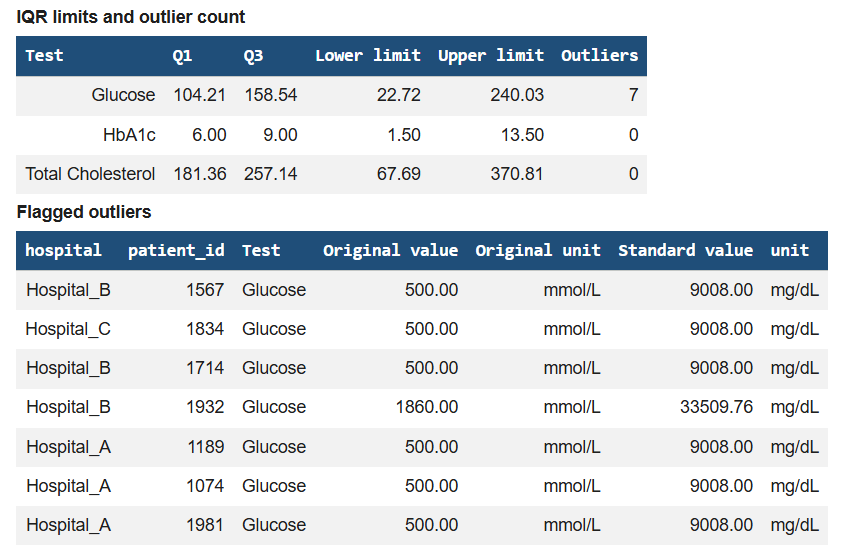
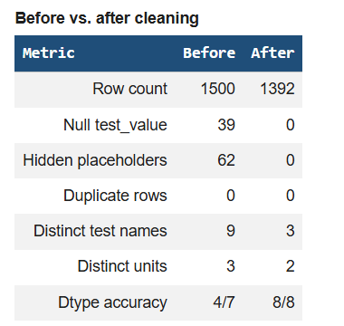

# 🏥 Data Cleaning: Multi-Hospital Lab Results

    

Turning a deliberately messy, multi-hospital lab dataset into a clean, analysis-ready table, with every cleaning decision documented and justified.

**Oasis Infobyte SIP** | **Data Analytics** | **Level 1, Task 3: Cleaning Data** | **Intern:** Fouzia Khan

---

## 📌 Highlights

| 1,500 → 1,392 | 62 | 9 → 3 | 8/8 |
|:---:|:---:|:---:|:---:|
| rows after cleaning (92.8% retained) | hidden missing values uncovered | test names standardised | columns with correct data types (was 4/7) |

- Found **hidden missing data** (`-999` and the text `not collected`) that a normal null check does not detect.
- Converted **mixed units** (mg/dL and mmol/L) into one unit per test.
- Detected and removed **7 physically impossible glucose values** using the IQR rule plus physiological limits.
- Chose **not to impute** clinical results, to avoid inventing patient measurements.

---

## 📖 Project Overview

Lab results from three hospitals were recorded inconsistently: the same test had several names, results used different units, missing values were hidden behind codes, and some entries were impossible. Analysing this data directly would give wrong answers, for example averaging glucose in mg/dL together with glucose in mmol/L.

This project builds a reproducible cleaning pipeline in a Jupyter/Colab notebook and exports a clean CSV.

## 🗂 Dataset

| Item | Detail |
|---|---|
| Name | Multi-Hospital Lab Results (Messy Data) |
| Author / Source | Nudrat Abbas, Kaggle |
| Size | 1,500 rows, 7 columns |
| Tests | Glucose, HbA1c, Total Cholesterol |
| Hospitals | Hospital_A, Hospital_B, Hospital_C |
| Period | 26 Mar 2024 to 26 Mar 2026 |

**Raw columns:** `hospital`, `patient_id`, `test_name`, `test_value`, `unit`, `reference_range`, `collection_date`

---

## 🔄 Workflow



## 🔎 Problems Found in the Raw Data

| # | Problem | Evidence |
|---|---|---|
| 1 | Hidden missing values | 62 values hidden as `-999` (36) or the text `not collected` (26), plus 39 real nulls |
| 2 | Inconsistent test names | 9 spellings for only 3 real tests (e.g. Glucose / Fasting Glucose / Blood Sugar) |
| 3 | Mixed units | Glucose and cholesterol reported in both mg/dL and mmol/L |
| 4 | Unstructured reference ranges | 9 text formats such as `70-99`, `Normal: <100`, `<5.7%` |
| 5 | Impossible values | 7 glucose entries (e.g. 500 and 1860 recorded in mmol/L) |
| 6 | Wrong data types | `test_value` and `collection_date` stored as text, `patient_id` as a number |

## 🧹 Cleaning Approach

| Step | Action | Why |
|---|---|---|
| 1. Quality report | Scorecard of nulls, placeholders, duplicates, distinct labels and dtypes | Measure the mess before changing anything |
| 2. Missing values | Converted `-999` and `not collected` to `NaN`, then dropped those rows | A lab result is a patient measurement. Imputing an average would invent a clinical result that was never measured |
| 3. Test names | Mapped 9 spellings to 3 standard names | Makes records of the same test comparable, and lets the duplicate check recognise synonyms |
| 4. Units | Converted mmol/L to mg/dL (glucose × 18.016, cholesterol × 38.67); HbA1c kept in % | One unit per test |
| 5. Reference ranges | Parsed text into numeric `reference_low` and `reference_high` | Allows numeric comparison with results |
| 6. Dates | Converted to `datetime`, checked for invalid dates | Enables time-based analysis |
| 7. Duplicates | Checked exact duplicates and duplicates on hospital + patient + test + date, after standardisation | Synonyms of one test are recognised as the same record (0 found) |
| 8. Outliers | IQR rule per test, then removed only physiologically impossible values | In healthcare a high result can be a real patient, so extreme values are kept unless impossible |
| 9. Data types | IDs as string, repeating text as category, numbers as float | Correct types for analysis and memory |

## 🔁 Example Transformations

| Raw record | Cleaned record | What changed |
|---|---|---|
| Hospital_B, 1149, `Blood Sugar`, `80.77415407811968`, mg/dL, `70-99` | Glucose, `80.77`, mg/dL, low `70`, high `99` | Name standardised, value rounded, range parsed |
| Hospital_C, 1873, `Serum Cholesterol`, `4.09`, mmol/L, `<200` | Total Cholesterol, `158.16`, mg/dL, low `0`, high `200` | Name standardised, mmol/L converted to mg/dL |
| Hospital_B, 1279, `Fasting Glucose`, `5.98`, mmol/L, `70-99` | Glucose, `107.74`, mg/dL, low `70`, high `99` | Name standardised, mmol/L converted to mg/dL |
| Hospital_C, 1826, `Glucose`, `-999`, mmol/L, `70-99` | *Removed* | Hidden missing value, no result to analyse |

---

## 📊 Results (Before vs. After)

| Metric | Before | After |
|---|:---:|:---:|
| Row count | 1,500 | 1,392 |
| Null `test_value` | 39 | 0 |
| Hidden placeholders (`-999` / `not collected`) | 62 | 0 |
| Duplicate rows | 0 | 0 |
| Distinct test names | 9 | 3 |
| Distinct units | 3 | 2 (mg/dL, %) |
| Dtype accuracy (columns correct) | 4/7 | 8/8 |

**Rows removed:** 101 missing results, 0 duplicates, 7 impossible outliers (108 in total).

### Quick look at the clean data

| Test | Unit | Results | Mean | Median | Min | Max |
|---|---|:---:|:---:|:---:|:---:|:---:|
| Glucose | mg/dL | 441 | 127.90 | 127.68 | 70.80 | 180.16 |
| HbA1c | % | 478 | 7.52 | 7.50 | 4.50 | 10.50 |
| Total Cholesterol | mg/dL | 473 | 220.55 | 217.79 | 150.43 | 298.22 |

Before outlier removal, the 7 impossible entries pushed the glucose maximum to 33,509 mg/dL (after unit conversion) and inflated the glucose mean to 321 mg/dL. The cleaned mean is 127.90 mg/dL.

---

## 📦 Output Dataset

`data/cleaned/cleaned_multi_hospital_lab_results.csv` (1,392 rows, 10 columns)

| Column | Type | Meaning |
|---|---|---|
| `hospital` | category | Source hospital |
| `patient_id` | string | Patient identifier |
| `test_name` | category | Standard test name |
| `test_value` | float | Result in the standard unit |
| `unit` | category | Standard unit |
| `reference_low` | float | Lower bound of the normal range |
| `reference_high` | float | Upper bound of the normal range |
| `collection_date` | datetime | Sample date |
| `original_value` | float | Result as originally reported |
| `original_unit` | category | Unit as originally reported |

## ⚠️ Assumptions and Limitations

- **Outlier limits are my own choice.** Values outside Glucose 20 to 800 mg/dL, Total Cholesterol 50 to 600 mg/dL and HbA1c 3 to 20 % were treated as impossible. These are broad physiological limits, not clinical guidelines.
- **Reference ranges in mmol/L are detected by size.** A glucose or cholesterol range with an upper bound below 20 is treated as mmol/L and converted. This works for this dataset but is a heuristic.
- **Dropping missing rows reduces the sample** by 6.7%. This was preferred over inventing clinical values.
- This analysis is for learning purposes and is not for medical use.

---

## 📁 Repository Structure

```
OIBSIP/
└── DataAnalytics-L1-CleaningData-Healthcare/
    ├── cleaning_data_healthcare.ipynb
    ├── README.md
    ├── data/
    │   ├── raw/
    │   │   └── multi_hospital_lab_results.csv
    │   └── cleaned/
    │       └── cleaned_multi_hospital_lab_results.csv
    └── screenshots/
        ├── 01_quality_scorecard.png
        ├── 02_outliers_iqr.png
        └── 03_before_after.png
```

## ▶️ How to Run

1. The raw dataset is included in `data/raw/` (original source: Kaggle, "Multi-Hospital Lab Results (Messy Data)" by Nudrat Abbas).
2. Open `cleaning_data_healthcare.ipynb` in Google Colab.
3. Update the paths in the first code cell (`ZIP_PATH`, `WORK_DIR`, `OUTPUT_PATH`) if needed.
4. Run **Runtime > Run all**. The cleaned CSV is saved to `/content`; download it from the Colab file panel.

## 🛠 Tech Stack

- Python 3
- pandas and NumPy for cleaning
- Matplotlib for visualisation
- Jupyter Notebook / Google Colab

## 🎯 Skills Demonstrated

Data quality profiling, hidden-missing-value detection, unit standardisation, regular-expression parsing, outlier detection with the IQR method, data type correction, documenting decisions, and reproducible notebook design.

## 📸 Screenshots

| Data quality report | Outlier detection (IQR) | Before vs. after |
|---|---|---|
|  |  |  |

## 🚀 Future Improvements

- Move the cleaning logic into a reusable Python module with unit tests
- Validate results against clinical reference guidelines
- Add an interactive dashboard of results by hospital
- Flag abnormal results automatically using the parsed reference ranges

## 📄 License

Created for educational and portfolio purposes as part of the Oasis Infobyte Summer Internship Program.

---

**Fouzia Khan** | Data Analytics Intern, Oasis Infobyte | #oasisinfobyte
