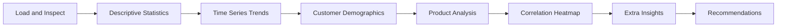
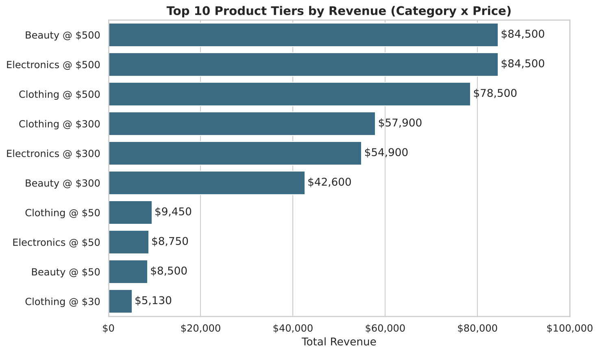
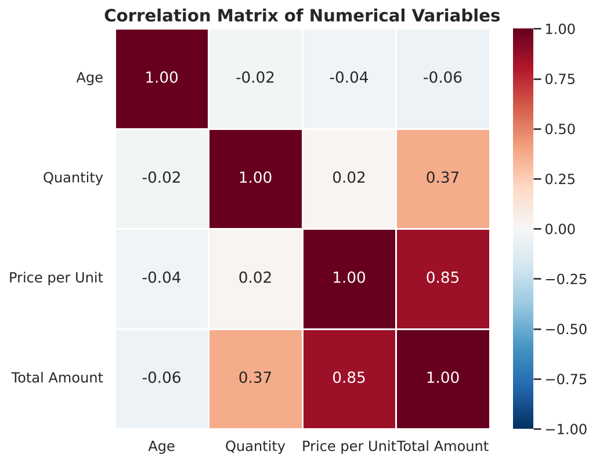
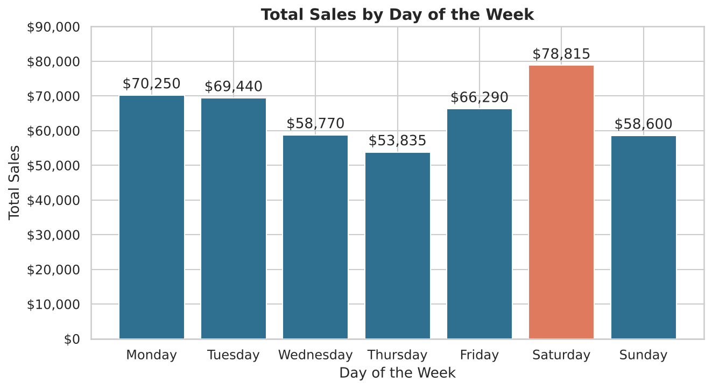
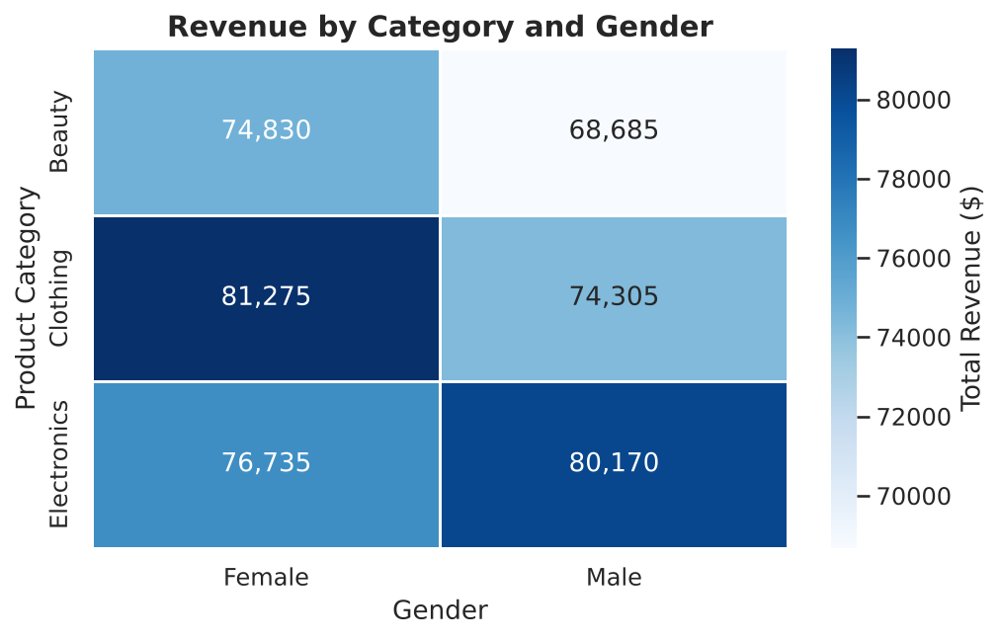
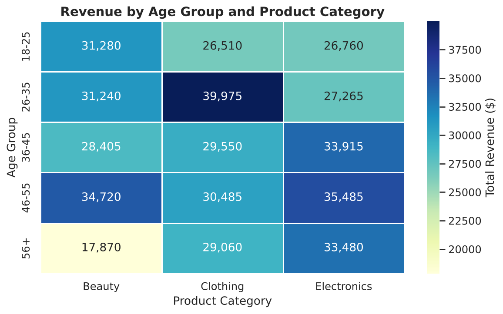

<div align="center">

# 🛍️ EDA on Retail Sales Data

**An exploratory data analysis of 1,000 retail transactions that uncovers sales trends, customer behaviour and practical business recommendations.**


[Overview](#-overview) · [Key Findings](#-key-findings) · [Visual Insights](#-visual-insights) · [Getting Started](#-getting-started) · [Recommendations](#-business-recommendations)

</div>

---

## 📖 Overview

A retail business needs to know **when** it sells most, **who** buys, and **what** drives its revenue. This project answers those questions with a full Exploratory Data Analysis (EDA) in Python.

It was completed as part of the **Data Analytics Internship at Oasis Infobyte (OIBSIP)**.

**The analysis answers:**
- How do sales change month by month and quarter by quarter?
- Which age groups and genders spend the most?
- Which product categories and price levels earn the most revenue?
- Which variables are related to revenue?
- What should the business do with these findings?

---

## 📊 Dataset

**Source:** Kaggle "Retail Sales Dataset" · **File:** `retail_sales_dataset.csv`

| Detail | Value |
|---|---|
| Rows | 1,000 transactions |
| Columns | 9 |
| Period | 2023-01-01 to 2024-01-01 |
| Missing values | None |
| Duplicate rows | None |

| Column | Description |
|---|---|
| `Transaction ID` | Unique ID of each sale |
| `Date` | Date of the sale |
| `Customer ID` | Unique customer (each ID appears once) |
| `Gender` | Male / Female |
| `Age` | Customer age (18-64) |
| `Product Category` | Beauty, Clothing or Electronics |
| `Quantity` | Items bought (1-4) |
| `Price per Unit` | \$25, \$30, \$50, \$300 or \$500 |
| `Total Amount` | Quantity × Price per Unit |

> **Notes**
> - The dataset has **no product-name column**, so the "top 10 products" step uses **Product Category × Price** tiers instead.
> - The currency is not stated. A dollar sign is used for display only.
> - Only **one day of January 2024** exists, so it is excluded from the trend charts.

---

## 🧰 Tech Stack

| Purpose | Tools |
|---|---|
| Language | Python |
| Data handling | pandas, NumPy |
| Visualisation | Matplotlib, Seaborn |
| Environment | Jupyter Notebook / Google Colab |

---

## 🔍 Analysis Workflow



| Step | What is done |
|---|---|
| 1. Load and inspect | Shape, data types, null and duplicate checks, Quantity × Price validation |
| 2. Descriptive statistics | Mean, median, mode and standard deviation |
| 3. Time series | Monthly and quarterly sales trend lines |
| 4. Demographics | Age groups, gender split and spend |
| 5. Product analysis | Revenue and units by category, top 10 product tiers |
| 6. Correlation | Heatmap of the numerical variables |
| 7. Extra insights | Category by gender, age group by category, day of week, basket size |
| 8. Conclusion | Data-backed business recommendations |

---

## 💡 Key Findings

| Metric | Result |
|---|---|
| **Total revenue** | \$456,000 |
| **Average transaction** | \$456 (median only \$135, so a few large orders lift the average) |
| **Best / weakest month** | May (\$53,150) / September (\$23,620) |
| **Best / weakest quarter** | Q4 (\$126,190) / Q3 (\$96,045) |
| **Premium items (\$300 and \$500)** | 39.6% of transactions but **88.4% of revenue** |
| **Category revenue** | Electronics \$156,905 · Clothing \$155,580 · Beauty \$143,515 |
| **Gender** | 51% female. Average spend is the same (\$456.55 vs \$455.43) |
| **Age** | 18-25 spend the most per transaction (\$500.30), 56+ the least (\$412.36) |
| **Busiest / quietest day** | Saturday (\$78,815) / Thursday (\$53,835) |
| **Basket size** | 4-item baskets are 26.3% of transactions but **40.8% of revenue** |

---

## 📈 Visual Insights

<table>
  <tr>
    <td align="center"><b>Monthly Sales Trend</b><br></td>
    <td align="center"><b>Top 10 Product Tiers</b><br></td>
  </tr>
  <tr>
    <td align="center"><b>Correlation Heatmap</b><br></td>
    <td align="center"><b>Sales by Day of the Week</b><br></td>
  </tr>
  <tr>
    <td align="center"><b>Revenue by Category and Gender</b><br></td>
    <td align="center"><b>Revenue by Age Group and Category</b><br></td>
  </tr>
</table>

All 11 charts are saved in the [`charts/`](charts) folder.

---

## ✅ Business Recommendations

1. **Push premium products.** Items priced at \$300 and \$500 bring 88.4% of revenue from 39.6% of transactions. Promote them and use cheap items as add-ons.
2. **Encourage bigger baskets.** 4-item baskets give 40.8% of revenue. Offer multi-buy discounts to move 2-3 item customers up.
3. **Fix the Q3 / September dip.** Q3 (\$96,045) trails Q4 (\$126,190), and September (\$23,620) is less than half of May. Plan a seasonal campaign before it.
4. **Plan for the weekday pattern.** Saturday earns \$78,815 against \$53,835 on Thursday. Stock and staff for weekends and run mid-week offers.
5. **Target by segment.** Promote Beauty and Clothing to women, Electronics to men, and a Beauty offer to customers aged 56+ (only \$17,870).

---

## 🚀 Getting Started

### Option 1: Google Colab
1. Upload `retail_sales_dataset.csv` to your Google Drive (My Drive).
2. Open `EDA_Retail_Sales.ipynb` in Colab.
3. Click **Runtime → Run all**. The notebook reads `/content/drive/MyDrive/retail_sales_dataset.csv`.

### Option 2: Run locally
```bash
git clone https://github.com/<your-username>/OIBSIP.git
cd OIBSIP/DataAnalytics-L1-EDARetailSales
pip install -r requirements.txt
jupyter notebook EDA_Retail_Sales.ipynb
```
Keep `retail_sales_dataset.csv` in the same folder as the notebook.

---

## 📁 Project Structure

```
DataAnalytics-L1-EDARetailSales/
├── EDA_Retail_Sales.ipynb      # Full analysis with outputs
├── retail_sales_dataset.csv    # Dataset
├── charts/                     # 11 saved charts (PNG)
├── requirements.txt            # Python dependencies
└── README.md
```

---

## 🔮 Future Improvements

- [ ] Build an interactive dashboard (Power BI or Streamlit)
- [ ] Add customer segmentation with RFM and K-Means
- [ ] Forecast monthly sales with a time series model
- [ ] Test the findings with statistical tests (for example, spend by gender)

---

## 👩‍💻 Author

**Fouzia Khan**
Data Analytics Intern, Oasis Infobyte (OIBSIP)
[GitHub](https://github.com/<your-username>) · [LinkedIn](https://www.linkedin.com/in/<your-profile>)

⭐ If you found this project useful, please consider giving it a star.
