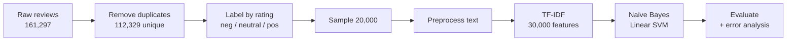
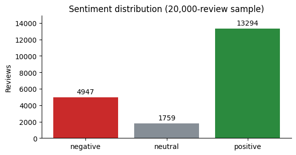
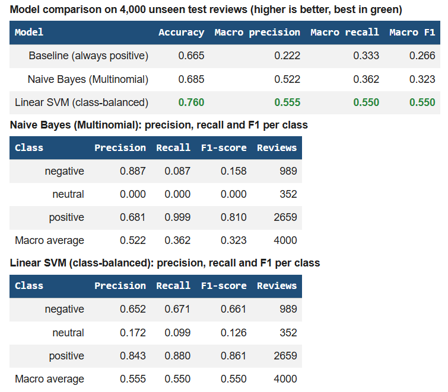
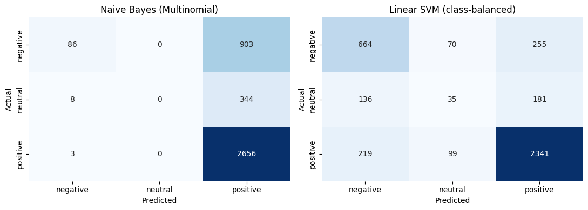
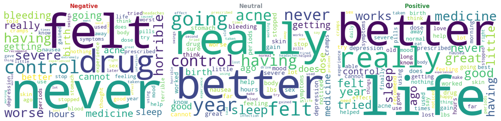

# 💊 Sentiment Analysis: Drug Reviews

    

Classifying patient drug reviews as **positive, neutral or negative**, comparing two models against a baseline, and being honest about where they fail.

**Oasis Infobyte SIP** | **Data Analytics** | **Level 1, Task 4: Sentiment Analysis** | **Intern:** Fouzia Khan

---

## 📌 Highlights

| 76.0% | 0.55 | 30% | 10% |
|:---:|:---:|:---:|:---:|
| accuracy of the best model (Linear SVM) | its macro F1, the main metric | of raw rows were duplicate review texts and removed | of neutral reviews found by the best model (the weak spot) |

- A baseline that **always predicts "positive"** already scores 66.5% accuracy, so accuracy alone is misleading on this data.
- **Naive Bayes with default settings** reached 68.5%, only 2 points above that baseline, because it predicts almost everything as positive.
- **Duplicate reviews were removed** before splitting. Identical texts in both train and test would have inflated every score.

---

## 📖 Project Overview

Drug reviews contain patient opinions about side effects and effectiveness. This project builds a text-classification pipeline that turns each review into a sentiment, using TF-IDF features and two classifiers, and evaluates it with metrics that suit imbalanced classes.

## 🗂 Dataset

| Item | Detail |
|---|---|
| Name | Drug Reviews (Drugs.com), UCI Drug Review Dataset |
| Source | UCI Machine Learning Repository, uploaded to Kaggle as "UCI ML Drug Review dataset" by Jessica Li |
| License | CC BY 4.0 |
| File used | `drugsComTrain_raw.csv` (161,297 reviews) |
| Columns used | `drugName`, `condition`, `review`, `rating` (1 to 10 stars) |

**Class balance in the 20,000-review sample:** positive 66.5% (13,294), negative 24.7% (4,947), neutral 8.8% (1,759).

The dataset has a star rating, not a sentiment label. **Labels were created with my own rule:** 1 to 4 stars = negative, 5 to 6 = neutral, 7 to 10 = positive. This is a choice, not a standard.

> The dataset (83 MB) is **not included** in this repository because of its size. Download it from Kaggle (link above) to re-run the notebook.

---

## 🔄 Workflow



## 🧹 Approach

| Step | Action | Why |
|---|---|---|
| Duplicates | Dropped repeated review texts (48,968 rows) | The same text in train and test would inflate scores |
| Labels | Rating 1 to 4 negative, 5 to 6 neutral, 7 to 10 positive | The dataset only has star ratings |
| Sample | 20,000 random reviews (fixed seed) | Keeps the notebook fast in Colab |
| Preprocessing | Decode HTML codes, lowercase, `n't` to `not`, keep letters only (tokenise), remove stopwords, drop single letters | Cleans noise (65% of reviews contain HTML codes) |
| Negations kept | `not`, `no`, `never`, `nor`, `cannot`, `nothing`, `none` stay in the text | "not good" means the opposite of "good" |
| TF-IDF | Unigrams and bigrams, 30,000 features, fitted on training data only | Weights distinctive words and avoids test-data leakage |
| Split | 80/20, stratified (16,000 train, 4,000 test) | Keeps class proportions equal in both sets |
| Models | Multinomial Naive Bayes (default) and Linear SVM with balanced class weights, plus an "always positive" baseline | Balanced weights give rare classes more influence |
| Metric | Macro F1 next to accuracy | Positive reviews dominate (66%), so accuracy hides weak classes |

## 📊 Results

Test set of 4,000 unseen reviews:

| Model | Accuracy | Macro precision | Macro recall | Macro F1 |
|---|:---:|:---:|:---:|:---:|
| Baseline (always positive) | 0.665 | 0.222 | 0.333 | 0.266 |
| Naive Bayes (Multinomial) | 0.685 | 0.522 | 0.362 | 0.323 |
| **Linear SVM (class-balanced)** | **0.760** | **0.555** | **0.550** | **0.550** |

**Linear SVM, per class:**

| Class | Precision | Recall | F1 | Reviews |
|---|:---:|:---:|:---:|:---:|
| Negative | 0.652 | 0.671 | 0.661 | 989 |
| Neutral | 0.172 | 0.099 | 0.126 | 352 |
| Positive | 0.843 | 0.880 | 0.861 | 2,659 |
| Macro average | 0.555 | 0.550 | 0.550 | 4,000 |

### What the results really say

- **The SVM is the best model, but not a strong one.** It beats the baseline by about 10 points of accuracy and doubles its macro F1.
- **Naive Bayes mostly predicts "positive".** It finds 99.9% of positive reviews, but only 8.7% of negative and 0% of neutral ones. I did not tune it (for example its smoothing value), so this describes default settings only.
- **Neutral reviews are nearly undetectable.** They sit in a narrow rating band (5 to 6 stars) and share wording with both other classes.

---

## ⚠️ Assumptions and Limitations

- **Labels come from star ratings**, not from human annotation, so some review texts disagree with their rating.
- **Only a 20,000-review sample** was used, with a single train/test split. There was no cross-validation and no hyperparameter tuning.
- **Neutral class is weak** (10% recall for the best model) and would need more data or a different approach.
- Stopwords come from scikit-learn's list (with negations kept). Stemming and lemmatisation were not applied.
- This is a learning project and must not be used for clinical decisions.

---

## 📁 Repository Structure

```
OIBSIP/
└── DataAnalytics-L1-SentimentAnalysis-DrugReviews/
    ├── sentiment_analysis_drug_reviews.ipynb
    ├── README.md
    └── screenshots/
        ├── 01_class_distribution.png
        ├── 02_model_comparison.png
        ├── 03_confusion_matrices.png
        └── 04_wordclouds.png
```

## ▶️ How to Run

1. Download the dataset from Kaggle ("UCI ML Drug Review dataset") and upload the zip to Google Drive.
2. Open `sentiment_analysis_drug_reviews.ipynb` in Google Colab.
3. Update `ZIP_PATH` in the first code cell to match your Drive path.
4. Run **Runtime > Run all**.

## 🛠 Tech Stack

- Python 3
- pandas
- scikit-learn (TF-IDF, Naive Bayes, Linear SVM, metrics)
- Matplotlib, seaborn and wordcloud
- Google Colab

## 🎯 Skills Demonstrated

Text preprocessing, TF-IDF feature extraction, handling duplicates and data leakage, class imbalance awareness, model comparison against a baseline, confusion-matrix and per-class evaluation, and error analysis.

## 📸 Screenshots

| Class distribution | Model comparison |
|---|---|
|  |  |

| Confusion matrices | Word clouds |
|---|---|
|  |  |

## 🚀 Future Improvements

- Tune Naive Bayes (smoothing value) or try Complement Naive Bayes, which is designed for imbalanced text
- Cross-validation and a proper hyperparameter search
- Treat neutral separately, for example by merging it with another class or using more data
- Try lemmatisation and compare it against the current preprocessing

## 📄 License

Created for educational and portfolio purposes as part of the Oasis Infobyte Summer Internship Program. The dataset is licensed CC BY 4.0 by its original authors.

---

**Fouzia Khan** | Data Analytics Intern, Oasis Infobyte | #oasisinfobyte
