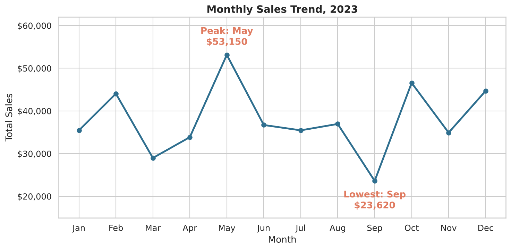

<div align="center">

# 📊 OIBSIP: Data Analytics Internship Projects

**Oasis Infobyte Summer Internship Program · Data Analytics Track · Level 1**

Three end-to-end data projects covering **data cleaning**, **machine learning (NLP)** and **exploratory analysis**, each with a documented notebook, clear findings and business or practical takeaways.


[Projects](#-projects) · [Highlights](#-project-highlights) · [Skills](#-skills-demonstrated) · [Structure](#-repository-structure) · [Run Locally](#-how-to-run) · [About](#-about-me)

</div>

---

## 👩‍💻 About This Repository

This repository contains my work for the **Data Analytics Internship at Oasis Infobyte (OIBSIP)**. Every project follows the same approach: understand the data, document each decision, and turn the results into conclusions that someone can act on.

---

## 📁 Projects

| # | Project | What it does | Tools | Link |
|---|---|---|---|---|
| 1 | 🏥 **Data Cleaning: Multi-Hospital Lab Results** | Turns a deliberately messy lab dataset into a clean, analysis-ready table and documents every cleaning decision | pandas, NumPy, Matplotlib | [Open project](DataAnalytics-L1-CleaningData-Healthcare) |
| 2 | 💊 **Sentiment Analysis: Drug Reviews** | Classifies patient reviews as positive, neutral or negative with TF-IDF, Naive Bayes and Linear SVM | scikit-learn, pandas, Matplotlib | [Open project](DataAnalytics-L1-SentimentAnalysis-DrugReviews) |
| 3 | 🛍️ **EDA on Retail Sales Data** | Explores 1,000 retail transactions to find sales trends, customer behaviour and business recommendations | pandas, Matplotlib, Seaborn | [Open project](DataAnalytics-L1-EDARetailSales) |

---

## 💡 Project Highlights

### 🏥 1. Data Cleaning: Multi-Hospital Lab Results
- Cleaned **1,500 raw rows to 1,392** (92.8% retained).
- Found **hidden missing values** (`-999` and the text `not collected`) that a normal null check misses.
- Standardised **9 test names into 3** and converted mixed units (mg/dL and mmol/L) to one unit per test.
- Removed **7 impossible glucose values** using the IQR rule plus physiological limits.
- Chose **not to impute** clinical results, so no patient measurement was invented.
- Brought data type correctness from **4 of 7 to 8 of 8** columns.

### 💊 2. Sentiment Analysis: Drug Reviews
- Built a three-class classifier on a 20,000-review sample of the UCI Drug Review dataset.
- **Best model: Linear SVM with 76.0% accuracy and 0.55 macro F1.**
- A baseline that always predicts "positive" already scores **66.5%**, so macro F1 is used next to accuracy.
- Removed duplicate review texts before the split to avoid inflated scores.
- Error analysis shows the **neutral class is the weak spot** (10% recall).

### 🛍️ 3. EDA on Retail Sales Data
- **Total revenue \$456,000** across 1,000 transactions.
- Items priced at \$300 and \$500 are **39.6% of transactions but 88.4% of revenue**.
- **May is the best month, September the weakest.** Q4 is the strongest quarter.
- **Saturday is the busiest day.** 4-item baskets give **40.8% of revenue**.
- Ended with **5 data-backed business recommendations**.

---

## 🖼️ Preview

<table>
  <tr>
    <td align="center"><b>Cleaning: Before vs After</b><br></td>
    <td align="center"><b>Sentiment: Model Comparison</b><br></td>
    <td align="center"><b>Retail: Monthly Sales Trend</b><br></td>
  </tr>
</table>

---

## 🧰 Skills Demonstrated

| Area | What I practised |
|---|---|
| **Data cleaning** | Hidden missing values, duplicates, unit and format standardisation, outlier detection (IQR), data type correction, before/after validation |
| **Exploratory analysis** | Descriptive statistics, time series trends, demographic and product analysis, correlation heatmaps |
| **Machine learning (NLP)** | Text preprocessing, TF-IDF, Naive Bayes, Linear SVM, baseline comparison, confusion matrix, error analysis |
| **Data visualisation** | Clear, labelled charts with Matplotlib and Seaborn, with a written observation after each one |
| **Communication** | Documented decisions, honest limitations, and actionable business recommendations |

---

## 🗂️ Repository Structure

```
OIBSIP/
├── DataAnalytics-L1-CleaningData-Healthcare/
│   ├── cleaning_data_healthcare.ipynb
│   ├── data/
│   │   ├── raw/
│   │   └── cleaned/
│   ├── screenshots/
│   └── README.md
│
├── DataAnalytics-L1-SentimentAnalysis-DrugReviews/
│   ├── sentiment_analysis_drug_reviews.ipynb
│   ├── screenshots/
│   └── README.md
│
├── DataAnalytics-L1-EDARetailSales/
│   ├── EDA_Retail_Sales.ipynb
│   ├── retail_sales_dataset.csv
│   ├── charts/
│   └── README.md
│
└── README.md
```

Each project folder has its own `README.md` with the dataset, method, results and how to reproduce it.

---

## ▶️ How to Run

All notebooks run in **Google Colab** (recommended) or **Jupyter** locally.

```bash
git clone https://github.com/<your-username>/OIBSIP.git
cd OIBSIP
pip install pandas numpy matplotlib seaborn scikit-learn wordcloud jupyter
jupyter notebook
```

> The Sentiment Analysis dataset (83 MB) is not stored in this repository because of its size. Its project README links to the download.

---

## 📬 About Me

**Fouzia Khan**
Data Analytics Intern, Oasis Infobyte (OIBSIP)

[GitHub](https://github.com/<your-username>) · [LinkedIn](https://www.linkedin.com/in/<your-profile>)

---

<div align="center">

Created for educational and portfolio purposes as part of the Oasis Infobyte Summer Internship Program.

⭐ If you found these projects useful, please consider giving the repository a star.

</div>
